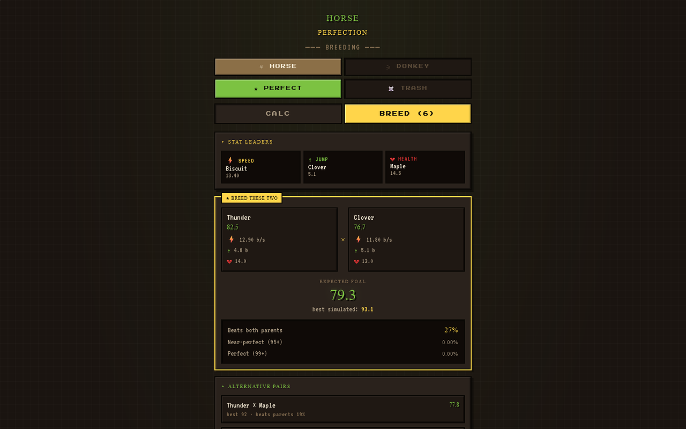
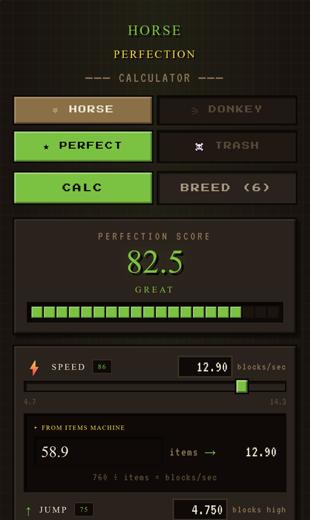

# Horse Perfection

A Minecraft horse and donkey calculator. Enter a horse's speed, jump and health to get a perfection score, keep a stable of your best horses, and see which two to breed next.

**[▶ Open the live app](https://timothyhadfield.github.io/craft-horse/)** · works on phone and laptop

  
  &nbsp;
  

## Features
- **Perfection score**: speed, jump and health each scaled against Minecraft's real minimum and maximum, averaged into one 0 to 100 score.
- **Enter stats the way you measure them**: speed from an items-per-trip count (760 ÷ items), jump in blocks plus snow layers, health in hearts.
- **Your stable**: save horses, load them back into the calculator, and delete the ones you release.
- **Breeding advice**: simulates 800 foals per pair and ranks every pair by expected foal, best result, and chance to beat both parents.
- **Stat leaders and culling**: shows who leads in each stat and which horses are beaten in every stat by another, so they're safe to let go.
- **Horse or donkey, perfect or trash**: four separate stables, including a "trash" mode that hunts for the worst possible horse.
- **Backup**: export all stables to a `stable.json` file and import it on another browser.

## Built with
One HTML page: React 18 and Babel from a CDN, pixel fonts from Google Fonts, and localStorage for saving.
